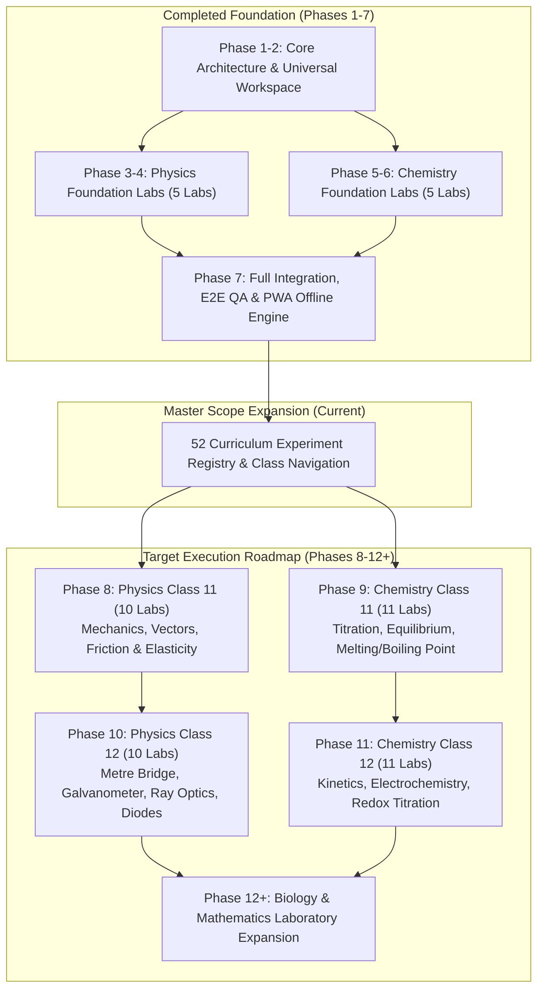

# PrayogaProof — Master Project Roadmap

**Document Version:** 2.0.0  
**Status:** Active Architectural Blueprint  
**Target Audience:** Engineering, Curriculum Designers, Pedagogical Reviewers  
**Platform Scope:** Cross-platform Web (PWA), Android (Capacitor), iOS (Capacitor)  

---

## 1. Executive Summary & Architecture Overview

PrayogaProof is a high-fidelity, interactive virtual STEM laboratory designed specifically for school students, with a primary focus on underserved communities and resource-constrained educational environments.

The platform employs a Cisco Packet Tracer–style free-form bench paradigm, allowing students to select authentic laboratory apparatus, drag them onto a multi-touch responsive Konva canvas, connect sensors and glassware, run physical/chemical simulations with deterministic equations, and record observations into an IndexedDB-persisted electronic lab notebook.

### Architectural Core Principles
1. **Decoupled Simulation Engines:** Physical models (circuit solvers, ray optics, harmonic motion, chemical reaction/equilibrium networks) are pure, headless TypeScript modules completely decoupled from React Konva rendering.
2. **Universal Three-Panel Lab Workspace:** Standardized interface containing an Apparatus/Reagents Palette on the left, an Interactive Canvas in the center, and an Inspector/Measurement panel on the right with a top-level undo/redo/save toolbar.
3. **Curriculum Classification:** Experiments are strictly catalogued across **Foundation (Classes 8–10)**, **Class 11**, and **Class 12**, aligned with national secondary education syllabi.
4. **Safety and Integrity:** Active experiments run real simulations with realistic error boundaries; unimplemented experiments are transparently marked as **"Under Development"** with full syllabus objectives and apparatus previews without broken controls.
5. **Strict Subject Isolation:** Physics and Chemistry engines operate independently. Biology and Mathematics remain strictly **ON HOLD ("Coming Soon")** until their specialized workflows (virtual microscopy, specimen dissection, 3D coordinate geometry) are aligned.

---

## 2. Master Implementation Phases

---

## 3. Phase Breakdown & Execution Plan

### Phase 1–7: Completed Foundation Baseline
- **Phase 1: Foundation & Application Shell:** Vite, React 18, TypeScript, Tailwind CSS, React Router v6, IndexedDB (`idb`), responsive mobile shell.
- **Phase 2: Universal Interactive Laboratory Workspace:** Three-panel Konva canvas, object inspector, undo/redo history, snap-to-grid, pan/zoom, mobile touch gestures.
- **Phase 3: Physics Electrical Laboratory:** Headless MNA nodal circuit solver, Ohm's Law, Series and Parallel networks, live ammeter/voltmeter probes.
- **Phase 4: Remaining Physics Foundation Experiments:** Convex Lens thin-lens optics model, Alnico Bar Magnet dipole field-line simulation, Simple Pendulum small-angle harmonic motion and $g$ calculation.
- **Phase 5: Chemistry Virtual Workbench:** Multi-apparatus container liquid transfer engine, fill-level visualization, pH universal indicator spectrum, turmeric & red cabbage colorimetric reactions.
- **Phase 6: Remaining Chemistry Foundation Experiments:** Capillary paper chromatography $R_f$ calculator, single displacement redox kinetics ($\text{Fe} + \text{CuSO}_4$), thermal copper sulphate crystallisation model.
- **Phase 7: System Integration & QA:** 19 Vitest test suites (161 unit/integration tests), 16 Playwright E2E tests, offline PWA manifest/Service Worker, zero build errors.

---

### Phase 8: Physics Class 11 — Mechanics, Vectors, Friction & Elasticity (10 Experiments)
**Focus:** Precision measurement instruments, Newtonian mechanics, statics, vectors, and fluid laws.
**Current Status:** All 10 of 10 Experiments Implemented and Operational (100% Complete).

| # | Experiment ID | Title | Status | Core Scientific Model Implemented / Operational |
|---|---------------|-------|--------|-------------------------------------------------|
| 1 | `vernier-callipers` | Vernier Callipers | **Implemented** | Dual-scale vernier slider with zero-error calibration ($ZE = \pm n \cdot LC$), least count $LC = 0.1\text{ mm}$ / $0.05\text{ mm}$, internal/external jaws, and cylinder/sphere volume calculation. |
| 2 | `screw-gauge` | Screw Gauge | **Implemented** | Pitch scale and circular thimble division tracker ($LC = 0.01\text{ mm}$), backlash/zero-error calibration, ratchet simulation, wire diameter/area, and glass plate thickness gauge. |
| 3 | `irregular-lamina` | Area of an Irregular Lamina | **Implemented** | Millimeter coordinate graph grid, 4x4 subgrid ray-casting boundary polygon integration, full ($N_1$), more-than-half ($N_2$), half ($N_3$) square counting, estimated area and boundary uncertainty $\Delta A$. |
| 4 | `spherometer` | Spherometer | **Implemented** | Three-legged pitch screw tripod with circular disk scale; circumradius $r_0 = l/\sqrt{3}$, sagitta $h = |h_1 - h_0|$, radius of curvature $R = \frac{l^2}{6h} + \frac{h}{2}$ for spherical lenses and mirrors. |
| 5 | `beam-balance` | Beam Balance | **Implemented** | Fulcrum moment balance ($\sum \tau = 0$), dual-pan suspension, arrestment handle mechanism, calibrated weight box (50g–1g + mg riders), damped oscillation dynamics $\theta(t)$, and resting point pointer oscillations. |
| 6 | `parallelogram-law` | Parallelogram Law of Vectors | **Implemented** | Gravesande's force board with low-friction pulleys, protractor degree scale, concurrent tensions $P, Q$, included angle $\theta$, analytical resultant $R = \sqrt{P^2 + Q^2 + 2PQ\cos\theta}$, component projections, and central equilibrant mass $S$. |
| 7 | `limiting-friction` | Laws of Limiting Friction | **Implemented** | Horizontal friction track with 4 surface pairs (wood, glass, sandpaper, steel), normal reaction $N = M_{\text{block}} g$, limiting threshold $f_{s,\max} = \mu_s N$, kinetic transition, and area independence (broad vs narrow face). |
| 8 | `inclined-plane-friction` | Friction on an Inclined Plane | **Implemented** | Variable-angle hinged ramp ($0^\circ \dots 60^\circ$), orthogonal gravitational decomposition ($N = mg\cos\theta, F_\parallel = mg\sin\theta$), angle of repose $\theta_r = \arctan(\mu_s)$, downward acceleration, and pulling effort up incline. |
| 9 | `hookes-law` | Hooke's Law and Spring Constant | **Implemented** | Coiled helical spring with real-time elastic extension, vertical mirror scale (anti-parallax), linear $F = k \cdot x$ slope determination, elastic potential energy $U = \frac{1}{2}kx^2$, dynamic harmonic oscillation $T = 2\pi\sqrt{m/k}$, and plastic yield limit. |
| 10 | `boyles-law` | Boyle's Law | **Implemented** | Airtight graduated gas cylinder (15–120 mL), movable piston, connected dial pressure gauge (0–300 kPa), isothermal $P \cdot V = \text{Constant}$ verification, manometer mercury head $\Delta h$, and linear $P$ vs $1/V$ plotting. |

---

### Phase 9: Chemistry Class 11 — Core Techniques, Equilibria & Titration (11 Experiments)
**Focus:** Quantitative volumetric titrations, thermal phase changes, chemical equilibria, and systematic qualitative inorganic analysis.
**Current Status:** All 11 of 11 Experiments Implemented and Operational (100% Complete — Phase 8 Complete).

| # | Experiment ID | Title | Status | Core Scientific Model Implemented / Operational |
|---|---------------|-------|--------|-------------------------------------------------|
| 1 | `basic-lab-techniques` | Basic Laboratory Techniques | **Implemented** | 50 mL graduated burette on retort stand with stopcock valve, digital analytical balance ($d = 0.001\text{ g}$) with electronic tare subtraction, volumetric cylinder meniscus alignment, gravimetric transfer verification ($\rho \approx 1.000\text{ g/mL}$). |
| 2 | `melting-point` | Melting Point Determination | **Implemented** | Thiele tube with liquid paraffin convection circulation loop, precision thermometer (0–360°C), micro-capillary sample holder, pure compounds (Benzoic acid $122.4^\circ\text{C}$, Urea $133.0^\circ\text{C}$, Naphthalene $80.2^\circ\text{C}$) sharp melting vs impure sample (5% cinnamic acid) depressed melting range ($114.5 - 118.5^\circ\text{C}$). |
| 3 | `boiling-point` | Boiling Point Determination | **Implemented** | Siwoloboff inverted micro-capillary in fusion tube, volatile solvents (Ethanol $78.3^\circ\text{C}$, Acetone $56.1^\circ\text{C}$, Ethyl Acetate $77.1^\circ\text{C}$, Water $100^\circ\text{C}$), Clausius-Clapeyron barometric pressure correction, continuous vapor bubble train, liquid suction re-entry temperature capture. |
| 4 | `crystallisation-class11` | Crystallisation | **Implemented** | **Reuses & extends crystallisation engine** for Class 11 impure sample purification: hot solvent dissolution, hot gravity filtration with fluted filter paper, concentration to crystallisation point, undisturbed lattice growth, percentage recovery yield calculation ($82.5\%$). |
| 5 | `ph-determination` | pH Determination | **Implemented** | **Reuses & extends pH engine** for Class 11: biological fruit juices (orange juice pH 3.6, tomato extract pH 4.3, apple juice pH 3.9), salt hydrolysis shifts (acidic $\text{NH}_4\text{Cl}$ pH 5.13 vs basic $\text{CH}_3\text{COONa}$ pH 8.87), Henderson-Hasselbalch equimolar acetate buffer (pH 4.74). |
| 6 | `strong-vs-weak-acids` | Strong vs Weak Acids | **Implemented** | Dual comparator workstation comparing equimolar ($0.1\text{ M}, 0.01\text{ M}, 0.001\text{ M}$) $\text{HCl}$ vs $\text{CH}_3\text{COOH}$, Ostwald's dilution law ($\alpha = 100\%$ vs $\alpha = 1.31\%$), $[H^+]$ ratio ($76.1\times$), magnesium effervescence rate (vigorous vs gentle), identical stoichiometric $\text{H}_2$ volume ($24.0\text{ mL}$). |
| 7 | `chemical-equilibrium` | Chemical Equilibrium | **Implemented** | Closed equilibrium chamber modeling $\text{Fe}^{3+} + \text{SCN}^- \rightleftharpoons [\text{Fe(SCN)}]^{2+}$ solution complex ($K_c = 138\text{ M}^{-1}$ at $25^\circ\text{C}$, $\Delta H^\circ = -24.2\text{ kJ/mol}$) and $2\text{NO}_2(\text{g}) \rightleftharpoons \text{N}_2\text{O}_4(\text{g})$ gas compression/temperature shifts, Beer-Lambert absorbance at 450 nm, fluoride ion sequestration. |
| 8 | `standard-solution-prep` | Standard Solution Preparation | **Implemented** | Volumetric measuring flask ($250\text{ mL}$ Class A), digital analytical balance, primary standard oxalic acid dihydrate ($M_w = 126.07\text{ g/mol}$) or sodium carbonate, stoichiometric mass calculation ($w = \frac{M \cdot M_w \cdot V}{1000} = 3.152\text{ g}$), bottom-meniscus alignment, and homogenization. |
| 9 | `acid-base-titration` | Acid-Base Titration | **Implemented** | Integrated titration workbench with 50 mL graduated burette on retort stand, conical flask with magnetic swirling, diprotic oxalic acid vs $\sim 0.1\text{ M }\text{NaOH}$ titration ($2\text{NaOH} + \text{H}_2\text{C}_2\text{O}_4 \to \text{Na}_2\text{C}_2\text{O}_4 + 2\text{H}_2\text{O}$), phenolphthalein end-point detection at $V_{\text{eq}} = 40.0\text{ mL}$ ($\text{pH} \approx 8.4$, pale pink), derivative slope $d(\text{pH})/dV$. |
| 10 | `salt-analysis-class11` | Salt Analysis (Class 11) | **Implemented** | Multi-tube qualitative salt analysis workbench with standard catalogue of 8 salts ($\text{NH}_4\text{Cl}, \text{Pb(NO}_3)_2, \text{CuSO}_4, \text{FeSO}_4, \text{AlCl}_3, \text{ZnSO}_4, \text{CaCl}_2, \text{MgSO}_4$) across Zero through Group VI cations and dilute/conc/independent acid radicals with systematic educational decision trees. |
| 11 | `organic-element-detection` | Detection of Elements in Organic Compounds | **Implemented** | Safe virtual qualitative identification testing on pre-fused Lassaigne's sodium fusion extract: Prussian blue test for Nitrogen ($\text{Fe}_4[\text{Fe(CN)}_6]_3$), sodium nitroprusside (purple) and lead acetate (black $\text{PbS}$) tests for Sulphur, and $\text{AgNO}_3$ differential solubility tests for Halogens ($\text{AgCl, AgBr, AgI}$). |

---

### Phase 10: Physics Class 12 — Electromagnetism, Advanced Optics & Semiconductors (10 Experiments)
**Focus:** Bridge circuits, galvanometer conversion, ray optics in mirrors/prisms, and semiconductor physics.
**Current Status:** All 10 of 10 Experiments Implemented and Operational (100% Complete).

| # | Experiment ID | Title | Status | Core Scientific Model Implemented / Operational |
|---|---------------|-------|--------|-------------------------------------------------|
| 1 | `resistivity-vi-method` | Resistivity of a Wire Using the V-I Method | **Implemented** | Specimen wire board (Constantan, Nichrome, Copper, Manganin), screw gauge diameter measurement ($d = 0.50\text{ mm}$), millimeter ruler active length ($L = 100\text{ cm}$), regulated DC source, digital ammeter & voltmeter, Ohm's law slope resistance $R = V/I$, and specific resistivity $\rho = \frac{R \cdot A}{L} = \frac{R \pi d^2}{4L}$. |
| 2 | `metre-bridge` | Metre Bridge – Unknown Resistance | **Implemented** | 100 cm uniform Manganin wire, polished teak base with heavy brass strip gaps, known resistance box $R$, sliding knife-edge jockey, center-zero sensitive galvanometer, opposite deflection verification at ends, and Wheatstone bridge null balance determination $X = \frac{R(100-l)}{l}$. |
| 3 | `galvanometer-figure-of-merit` | Galvanometer Resistance and Figure of Merit | **Implemented** | Deadbeat Weston moving-coil galvanometer (30-0-30 scale), high resistance box $R = 4900\ \Omega$ (key $K_1$), low shunt resistance box $S = 100\ \Omega$ (key $K_2$), half-deflection model ($\theta \to \theta/2$), coil resistance $G = \frac{RS}{R-S} \approx S$, and Figure of Merit $k = \frac{E}{(R+G)\theta}$. |
| 4 | `galvanometer-voltmeter` | Conversion of Galvanometer into a Voltmeter | **Implemented** | Calibration test bench, target range selector (0.5–10V), theoretical series multiplier calculation $R_s = \frac{V}{I_g} - G$, effective voltmeter resistance $R_v = R_s + G$, multi-point test signal calibration against reference digital voltmeter, and overload alert detection ($V_{\text{test}} > V_{\max}$). |
| 5 | `galvanometer-ammeter` | Conversion of Galvanometer into an Ammeter | **Implemented** | Calibration test bench, target current range selector (0.1–10A), theoretical parallel shunt calculation $S = \frac{I_g \cdot G}{I - I_g}$, effective ammeter resistance $R_a = \frac{GS}{G+S}$, multi-point current calibration against reference digital ammeter, and current overload alert detection ($I_{\text{test}} > I_{\max}$). |
| 6 | `concave-mirror-focal-length` | Focal Length of a Concave Mirror | **Implemented** | Front-silvered concave mirror bench, optical axis, focus $F$ and center of curvature $C$ indicators, object needle ($u$), real inverted image on screen or virtual erect image behind mirror ($u < f$), mirror formula $1/f = 1/v + 1/u$, linear magnification $m = -v/u$, paraxial ray tracing. |
| 7 | `convex-mirror-focal-length` | Focal Length of a Convex Mirror | **Implemented** | Bulging convex mirror bench, virtual focus ($f > 0$) behind mirror, virtual erect diminished image ($v > 0, 0 < m < 1$), auxiliary convex lens retro-reflection setup ($R = 2f$), normal incidence ray reversal at center of curvature $C$. |
| 8 | `concave-lens-focal-length` | Focal Length of a Concave Lens | **Implemented** | Diverging biconcave lens bench ($f < 0$), virtual ray back-tracing, virtual erect diminished image on incident side, auxiliary convex lens combination method ($1/f_2 = 1/F_{\text{comb}} - 1/f_1$). |
| 9 | `prism-refractive-index` | Refractive Index of a Prism – Minimum Deviation | **Implemented** | Equilateral crown glass prism ($A = 60^\circ$) on graduated angle turntable, Snell's law refraction at both faces, minimum deviation condition ($i = e, r = A/2$), total internal reflection when $r_2 > \theta_c$, refractive index formula $\mu = \frac{\sin((A+D_m)/2)}{\sin(A/2)}$. |
| 10 | `pn-junction-diode` | P-N Junction Diode – I-V Characteristics | **Implemented** | Semiconductor characterization test bench, Silicon ($V_k \approx 0.7\text{ V}$) and Germanium ($V_k \approx 0.3\text{ V}$) crystals, forward/reverse bias polarity switch, series protective resistor $R_s$, dynamic AC resistance $r_{\text{ac}} = \Delta V / \Delta I$, reverse saturation leakage ($I_0 \approx 0.15\ \mu\text{A}$), avalanche breakdown ($V_{\text{br}} \approx 25\text{ V}$), interactive plotted I-V curve with active operating point. |

---

### Phase 11: Chemistry Class 12 — Physical, Organic & Analytical Chemistry (11 Experiments)
**Focus:** Reaction kinetics, electrochemical cells, redox titrations, functional group organic tests, and advanced salt analysis.
**Current Status:** 5 of 11 Experiments Implemented and Operational (Phase 9 Complete).

| # | Experiment ID | Title | Status | Core Scientific Model Implemented / Operational |
|---|---------------|-------|--------|-------------------------------------------------|
| 1 | `surface-chemistry` | Surface Chemistry | **Implemented** | Lyophilic starch sol and lyophobic ferric hydroxide sol preparation via boiling water hydrolysis of FeCl3, 650nm transverse laser Tyndall effect scattering cone, and Hardy-Schulze coagulation rule. |
| 2 | `chemical-kinetics` | Chemical Kinetics | **Implemented** | Redox precipitation kinetics: $\text{Na}_2\text{S}_2\text{O}_3 + 2\text{HCl} \to \text{S}\downarrow + 2\text{NaCl} + \text{SO}_2 + \text{H}_2\text{O}$, white glazed tile with black cross mark ($+$), top-down colloidal sulphur obscuration timing, first-order rate law $\text{Rate} = 1/t \propto [\text{Na}_2\text{S}_2\text{O}_3]$, and Arrhenius activation energy temperature acceleration. |
| 3 | `thermochemistry` | Thermochemistry | **Implemented** | Polystyrene cup calorimeter, water equivalent $W = 25\text{ J/K}$, enthalpy of neutralization ($\text{HCl} + \text{NaOH}$, theoretical $\Delta H^\circ = -57.32\text{ kJ/mol}$), temperature-time cooling curve, and enthalpy of solution ($\text{KNO}_3$). |
| 4 | `electrochemistry` | Electrochemistry | **Implemented** | Galvanic Daniell cell: $\text{Zn} \mid \text{Zn}^{2+} \parallel \text{Cu}^{2+} \mid \text{Cu}$, agar-agar $\text{KCl}$ salt bridge, digital high-impedance voltmeter, standard cell potential $E^\circ = +1.103\text{ V}$, open-circuit 0.000 V without salt bridge, reversed polarity, and Nernst equation verification. |
| 5 | `paper-chromatography-class12` | Paper Chromatography | **Implemented** | **Reuses & extends Foundation module (`paper-chromatography`)** with Class 12 presets: analytical separation of inorganic transition metal cations ($\text{Pb}^{2+}$ and $\text{Cd}^{2+}$) visualized via yellow ammonium sulphide spray reagent, and spinach chloroplast leaf pigment separation. |
| 6 | `inorganic-compound-prep` | Inorganic Compound Preparation | **Under Development** | Synthesis of double salts: Ferrous Ammonium Sulphate (Mohr's Salt) and Potash Alum, crystal yield and geometry. |
| 7 | `organic-compound-prep` | Organic Compound Preparation | **Under Development** | Preparation of acetanilide, dibenzalacetone, or $p$-nitroacetanilide; crystallization and yield calculation. |
| 8 | `functional-group-identification` | Functional Group Identification | **Under Development** | Systematic diagnostic tests for alcohols (Ceric ammonium nitrate, sodium metal), phenols ($\text{FeCl}_3$), aldehydes (Tollens' silver mirror, Fehling's), ketones, and carboxylic acids ($\text{NaHCO}_3$ effervescence). |
| 9 | `food-component-testing` | Food Component Testing | **Under Development** | Biochemical spot tests: Biuret & Ninhydrin for proteins, iodine test for starch, saponification & Sudan III for fats. |
| 10 | `redox-titration-kmno4` | Redox Titration – Potassium Permanganate | **Under Development** | Self-indicating $\text{KMnO}_4$ burette titration against Mohr's salt and oxalic acid in dilute $\text{H}_2\text{SO}_4$, warm heating to $60^\circ\text{C}$, equivalence end-point detection. |
| 11 | `salt-analysis-class12` | Salt Analysis (Class 12) | **Under Development** | Advanced qualitative analysis including interfering anions ($\text{PO}_4^{3-}, \text{C}_2\text{O}_4^{2-}, \text{BO}_3^{3-}, \text{F}^-$) and group-wise separation schemes. |

---

### Phase 12+: Long-Term Horizon — Biology & Mathematics
- **Status:** Strictly **ON HOLD** ("Coming Soon").
- **Integration Points Preserved:**
  - Subject cards with visual status pills, planned quarter metadata, and direct routing to `/subjects/biology` and `/subjects/mathematics`.
  - Future engines under exploration:
    - **Biology:** Virtual compound microscope with objective turret zoom, slide focus knobs, and cellular stain overlays.
    - **Mathematics:** Interactive 2D coordinate graphing, vector cross-product visualization, and dynamic 3D polyhedra manipulations.

---

## 4. Verification and Governance Gates

Every future phase must satisfy the following strict gating criteria before merging:
1. **Zero Regression:** All existing Foundation experiments (5 Physics, 5 Chemistry) must maintain 100% operational fidelity.
2. **Deterministic Modeling:** Simulations must execute verified mathematical equations with published assumptions.
3. **Type Safety:** `tsc -b` must pass with zero TypeScript errors under strict mode.
4. **Lint Compliance:** `npm run lint` must produce zero ESLint errors.
5. **Automated Testing:**
   - Vitest suite must test all state transitions, boundary conditions, and calculation accuracy.
   - Playwright E2E tests must verify canvas rendering, dragging, touch gestures, and navigation.
6. **No Remote Push Without Explicit Approval:** Work is committed to local Git branches only until user reviews and instructs deployment.
