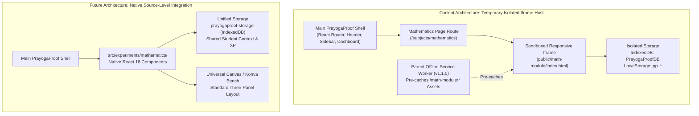

# PrayogaProof — Mathematics Module Integration Guide

**Integration Branch:** `suhaas-mathematics`  
**Host Application:** PrayogaProof Core (React 18 + Vite + TypeScript + Tailwind CSS)  
**Integrated Module:** Mathematics Module for Classes 10, 11 & 12 (delivered by teammate Suhaas)  
**Integration Strategy:** Isolated Offline Static Application Hosted via Sandboxed Responsive Frame (Phase 2 Compatible Architecture)

---

## 1. Overview & Architectural Rationale

Teammate Suhaas delivered the Mathematics module as a compiled, minified production package (`math module.zip`) containing compiled JavaScript (`index-BR0wpfdv.js`), stylesheet (`index-DcihOyag.css`), an offline launcher, local server, and a service worker. Because this is a compiled distribution rather than modular React source code, integrating it requires a disciplined architectural separation.

### Temporary Compiled-Build Integration vs. Future Native Integration



### Why the Isolated Static Frame is Required for the Compiled Build:
1. **DOM and Style Encapsulation:** The compiled CSS bundle (`index-DcihOyag.css`) contains compiled Tailwind resets and global utility classes that would collide with PrayogaProof's existing design tokens and light/dark mode implementations if injected into the root document.
2. **State & Router Isolation:** The compiled bundle contains an internal React state view manager. Hosting it in an isolated frame allows students to navigate between Home, Math Labs, 3D Geometry, and the JEE Arena without triggering route conflicts in the parent React Router.
3. **Database Name Isolation:** The Mathematics module uses `PrayogaProofDB` while PrayogaProof uses `prayogaproof-storage`. Both operate on the same origin without namespace collisions.
4. **Zero Code Duplication:** Rebuilding the 493 KB minified bundle from scratch without verified source files risks introducing subtle regressions in numerical solvers, 3D projection formulas, or question banks.

---

## 2. Integration Implementation Details

### Step 1: Secure Archive Extraction & Path Normalization
- The ZIP archive contained Windows-style backslashes (`assets\index-BR0wpfdv.js`, `icons\logo.svg`).
- Extracted into `public/math-module/` with backslash-to-slash path sanitization.
- Cleaned directory layout:
  ```
  public/math-module/
  ├── index.html
  ├── manifest.json
  ├── server.js
  ├── LAUNCH_PRAYOGAPROOF.bat
  ├── README_OFFLINE.txt
  ├── sw.js
  ├── icons/logo.svg
  └── assets/
      ├── index-BR0wpfdv.js
      └── index-DcihOyag.css
  ```

### Step 2: Asset Path Normalization in `index.html`
- Updated script and link tags from root-absolute (`/assets/...`, `/icons/...`) to relative (`./assets/...`, `./icons/...`):
  ```html
  <script type="module" crossorigin src="./assets/index-BR0wpfdv.js"></script>
  <link rel="stylesheet" crossorigin href="./assets/index-DcihOyag.css">
  <link rel="icon" type="image/svg+xml" href="./icons/logo.svg" />
  ```
- Confirmed that neither `index-BR0wpfdv.js` nor `index-DcihOyag.css` contains hardcoded root asset references.

### Step 3: Service Worker Conflict Resolution & Offline Caching
- **Problem:** The child `index.html` attempted to register `/sw.js` with root scope (`/`), which would displace the parent PrayogaProof service worker (`prayogaproof-core-v1.0.0`).
- **Resolution:**
  1. Disabled the child service worker registration script in `public/math-module/index.html`.
  2. Updated the parent service worker (`public/sw.js`) to version `1.1.0`.
  3. Added the Mathematics module assets to the parent's `CORE_ASSETS` pre-cache list:
     ```javascript
     const CORE_ASSETS = [
       '/',
       '/index.html',
       '/manifest.json',
       '/favicon.svg',
       '/math-module/index.html',
       '/math-module/assets/index-BR0wpfdv.js',
       '/math-module/assets/index-DcihOyag.css',
       '/math-module/icons/logo.svg',
     ];
     ```
  4. Configured navigation fallback in `public/sw.js` so offline requests matching `/math-module/` return the cached `/math-module/index.html`.

### Step 4: Parent Routing & Mathematics Page Component
- Created `src/pages/MathematicsPage.tsx`:
  - Consistent PrayogaProof breadcrumbs: `Dashboard > Mathematics Laboratory`
  - Purple accent branding (`#7c3aed`), curriculum badges (41 Chapters, 12 Simulators, Offline Ready)
  - Interactive toolbar: "Back to Dashboard", "Reload" frame, and "Full Tab" link
  - Responsive `iframe` host with sandboxing attributes:
    ```html
    <iframe
      src="/math-module/index.html"
      title="PrayogaProof Interactive Mathematics Laboratory"
      sandbox="allow-scripts allow-same-origin allow-forms allow-modals allow-downloads"
      className="w-full h-[calc(100vh-210px)] min-h-[760px] border-0 block"
    />
    ```
- Updated `src/App.tsx` routing:
  ```tsx
  <Route path="subjects/biology" element={<ComingSoonPage subjectId="biology" />} />
  <Route path="subjects/mathematics" element={<MathematicsPage />} />
  ```

### Step 5: Dashboard & Subject Registry Synchronization
- Updated `src/services/experimentRegistry.ts`:
  - `status: 'active'`
  - `totalExperiments: 12`
  - `availableExperiments: 12`
  - Tagline: `"Classes 10–12 Interactive Mathematics & Labs"`
- Updated `src/components/layout/Sidebar.tsx`:
  - Mathematics link: Active, badge `"Classes 10-12"`, active color `text-purple-600 dark:text-purple-400`
  - Biology link: Unchanged, `comingSoon: true`, badge `"Soon"`
- Updated `src/components/shared/SubjectCard.tsx`:
  - Configured purple progress indicators and button hover states for `subject.id === 'mathematics'`.

---

## 3. Requirements for Teammate Suhaas (Future Native Integration)

To migrate from the temporary iframe architecture to a 100% native source-level integration inside `src/experiments/mathematics/`, teammate Suhaas must provide the following:

### 1. Unminified Source Repository
- Complete `src/` directory containing uncompiled JSX/TSX components:
  - `src/simulator/` (e.g. `Simulators1To6.jsx`, `Simulators7To12.jsx`, `Simulators13To18.jsx`, `MathLab.jsx`)
  - `src/visualisations/` (`ThreeDViewer.jsx`)
  - `src/graph-engine/` (`GraphCanvas.jsx`)
  - `src/curriculum/` (`curriculumData.js`)
  - `src/jee/` (`JeePrep.jsx`, `jeeQuestionBank.js`)
  - `src/grading/` (`VisualCorrection.jsx`)
  - `src/viva/` (`VivaExam.jsx`)
- Complete `package.json` specifying exact versions of peer dependencies (`framer-motion`, `canvas-confetti`, `lucide-react`).

### 2. Standardization to TypeScript (`.tsx`)
- All components must be typed using standard TypeScript interfaces matching PrayogaProof's code standards.
- Remove untyped `any` parameters in mathematical solvers and geometry generators.

### 3. State & Storage Unification
- Replace standalone `PrayogaProofDB` in `db.js` with PrayogaProof's central database service (`src/services/db.ts`).
- Connect experiment observation logging, quiz scores, and XP directly to `StudentContext` (`useStudent()`) so mathematics achievements appear in the global student analytics dashboard.

### 4. Layout & Theme Consistency
- Align components with PrayogaProof's universal three-panel workspace layout (`Toolbar`, `Canvas / Interactive Stage`, `Inspector / Auto-Log`).
- Adopt PrayogaProof's shared design tokens (`bg-slate-900`, `border-slate-800`, light/dark theme classes).
